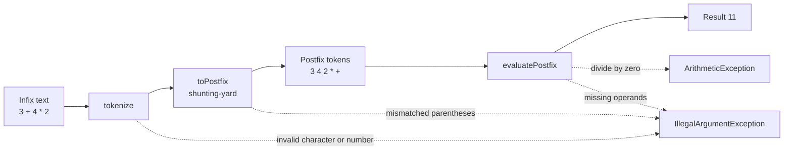

# ShuntCalc

An infix expression calculator built on the **shunting-yard algorithm**, with a small AWT desktop front end.

## Features

- Operators `+ - * /` with correct precedence and left associativity
- Parentheses, including nesting
- Decimal numbers (`1.5 * 2.5`, `.5`, `5.`)
- Unary minus and plus (`-(2 + 3)`, `2 * -3`)
- Clear errors for malformed input, mismatched parentheses, division by zero and results outside the `double` range
- Calculator window (AWT) with digit, decimal point, operator and parenthesis keys, a delete key and keyboard input (digits, operators, `Enter` or `=` to evaluate, `Backspace` to delete, `Esc` to clear)
- Results are shown as plain decimal text (no scientific notation), so they can be used in the next expression

## How it works



1. **Tokenize** splits the text into numbers, operators and parentheses. A `-` at the start, after an operator or after `(` becomes an internal unary-negate token.
2. **Shunting-yard** converts the tokens to postfix using an operator stack. Precedence is `neg` (3), `* /` (2), `+ -` (1). Operators of equal precedence pop left to right. `neg` is right associative.
3. **Postfix evaluation** uses an operand stack. Any leftover or missing operand is rejected.

## Project structure

```
pom.xml
src/
  main/java/dev/praneetha/shuntcalc/
    ExpressionEvaluator.java   tokenizer, shunting-yard, postfix evaluator
    CalculatorApp.java         AWT front end with keypad and keyboard input
  test/java/dev/praneetha/shuntcalc/
    ExpressionEvaluatorTest.java
.github/workflows/ci.yml       build and test on every push
```

## Requirements

- JDK 17 or newer
- Maven 3.8 or newer

## Build, test and run

```bash
mvn -B verify                                   # compile and run the JUnit 5 tests
java -jar target/shuntcalc-1.0.0.jar            # open the calculator window
```

The jar manifest points at `dev.praneetha.shuntcalc.CalculatorApp`.

## Use as a library

```java
double value = ExpressionEvaluator.evaluate("(2 + 3) * 4"); // 20.0
```

## Tests

`ExpressionEvaluatorTest` covers precedence, associativity, parentheses and deep nesting, decimals (including `.5` and `5.`), whitespace, unary and binary operator mixes, the tokenizer, postfix output and direct postfix evaluation, division by zero, out-of-range results, result formatting, mismatched parentheses and malformed input. The tests are written but have not been run in CI yet.

## Limitations

- Only the four basic operators; no exponent, modulo or functions
- Uses `double`, so results carry floating-point rounding
- Implicit multiplication such as `2(3)` is rejected
- The AWT window is not covered by automated tests (it needs a display)

## Roadmap

- Exponent (right associative) and modulo operators
- Optional `BigDecimal` mode for exact decimal arithmetic
- Headless tests for the key-handling logic

## License

MIT. See [LICENSE](LICENSE).
